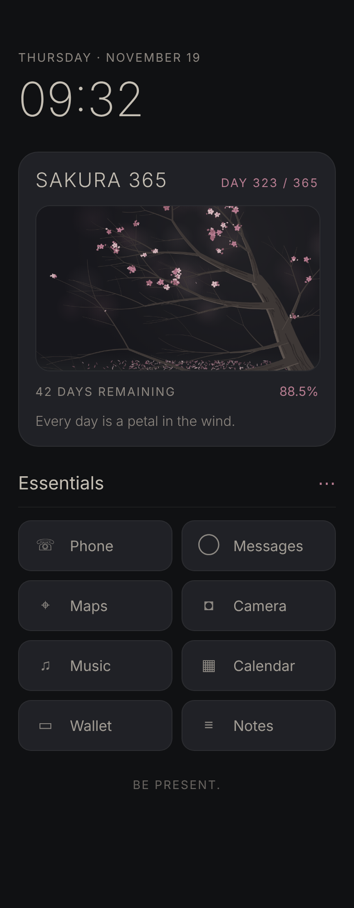

# SAKURA 365

A quiet iPhone home-screen companion: a sakura tree with exactly 365 blossoms,
one for each day of the year, above a minimal app launcher.
Dark only. SwiftUI, iOS 17+.



*(The preview images come from the browser prototype of the same tree algorithm.
Launcher glyphs in them are placeholders; the app uses SF Symbols.)*

## Open & run

Open `SAKURA365.xcodeproj` in Xcode 16 or later, choose a development team, and run.
Source folders are synchronized groups, so new files dropped into `SAKURA365/` are picked up automatically.

```
SAKURA365/
  App/        Sakura365App — dark-only scene and UIKit appearance
  Theme/      Palette — the eight brand colours and derived tones
  Sakura/     SakuraCalendar (dates → petals), SakuraTree (deterministic growth),
              Wind, SakuraRenderer (Canvas drawing), SakuraTreeView (TimelineView)
  Launcher/   models, catalog, persistence, grid, manage/add/edit sheets
  Home/       HomeView — clock, Sakura card, launcher
SAKURA365Tests/  calendar and determinism tests
Config/Info.plist  UIUserInterfaceStyle = Dark, LSApplicationQueriesSchemes
```

## Palette

| Token | Hex | Use |
|---|---|---|
| Midnight | `#101113` | app background |
| Charcoal | `#202126` | cards, tiles, list rows |
| Illustration | `#17171C` | behind the tree |
| Dusty Sakura | `#B77D91` | accent, counters, blossoms |
| Blossom | `#D5B7BC` | light petals, confirm buttons |
| Moonlight | `#C5BFB4` | primary text, icons |
| Secondary | `#8D8780` | captions |
| Muted Moss | `#657268` | dusk on the ground |

Borders are Moonlight at 8% opacity. The app has no light theme. `UIUserInterfaceStyle = Dark`
and `.preferredColorScheme(.dark)` both force dark mode.

## The tree

The tree is generated procedurally from a fixed seed (`SakuraTree.seed = 365`) with a
Mulberry32 PRNG, so every launch on every device draws the same tree.
The main trunk and limbs are composed by hand to match the reference: a thick trunk
entering from the bottom-right, a long limb reaching left, and dense blossoms in the
upper and left parts of the crown. Finer branches grow recursively, with drooping
limbs pulled back toward the light.

Rendering is a single `Canvas`:
- all wood is filled as one path, with a moonlit edge stroke and ink bark grain on thick limbs;
- the 365 blossoms are pre-built paths (a flower plus four buds each). Each frame
  applies one transform per blossom and fills three combined paths, one per tone;
- fallen petals are cached and rebuilt once per day.

### Wind
`Wind.intensity(t)` combines three octaves of smooth value noise (swells, gusts, flutter)
and multiplies them by a very slow *calm envelope*. When the envelope dips, the tree
becomes almost completely still for tens of seconds.

- The trunk's flex is ~0.004 rad, so it barely moves. Thin twigs flex up to 0.12 rad.
- Each branch has its own phase and frequency, built from two incommensurate sines.
- Wind reaches deeper branches later (0.22 s per level), and sway accumulates through
  the hierarchy, so outer twigs move most.
- Blossom clusters follow their branch with a small, individually delayed settle.
- Loose petals slip off occasionally, more often in stronger wind. Never more than about 4 are in the air.

### Battery
- `TimelineView(.animation(minimumInterval: 1/30, paused:))` runs at 30 fps at most.
- Frames stop entirely when the scene is not `.active` (background, app switcher,
  locked) or when the view is off screen.
- Low Power Mode drops the frame rate to 15 fps. Reduce Motion draws a still tree.

## The 365-day system

`SakuraDay` maps a date to `petalIndex` (0…364) using `Calendar.ordinality(of: .day, in: .year)`:

- **Past days:** petals `0 ..< petalIndex` lie beneath the tree, each in a fixed spot.
  Older petals fade into the ground.
- **Today:** petal `petalIndex` trembles, detaches, spins and drifts down to its spot on
  a 20-second loop. Its blossom stays on the branch at half opacity.
- **Future days:** all other blossoms stay on the branches.

The order in which blossoms fall is a seeded shuffle, so the crown thins evenly through
the year rather than branch by branch. Positions never regenerate.

### Leap years
The tree always has 365 blossoms. In a 366-day year:

- **Jan 1 – Feb 28:** same petals as in a common year (index 0–58).
- **Feb 29:** no new petal. The tree *holds its breath*: Feb 28's petal keeps falling
  for a second day, and the reflection line reads "A day between days."
- **Mar 1 – Dec 31:** the index is the ordinal minus 2, which is exactly the petal the
  same date has in a common year. Dec 31 is always petal 365.

So a date always means the same petal. The counters stay calendar-true: the card shows
`DAY 60 / 366`, the real days remaining, and the real percentage. This is covered by `SakuraDayTests`.

## Launcher

- Add apps from a catalog of Apple and popular apps, or add any custom app by name, URL
  and outline symbol (e.g. `shortcuts://run-shortcut?name=Camera`).
- Remove apps (swipe, or long-press → *Remove from launcher*), reorder by dragging, rename.
- Choose one or two columns. The section title is editable too.
- Everything is saved as JSON in `UserDefaults` (`sakura365.launcher.apps.v1`, `sakura365.launcher.settings.v1`).
- Icons are monochrome SF Symbols with light weights. There are no coloured app icons.

Apple's URL schemes such as `mobilephone://`, `shoebox://` and `mobilenotes://` are widely
used but not all are officially documented. If one stops working, edit its URL in the app.
iOS has no public URL scheme for Camera, so the default Camera entry runs a Shortcut
named "Camera". Create that Shortcut, or change the URL.

## Testing from Windows (no Mac)

Every push to `main` is built by GitHub Actions on a macOS runner (`.github/workflows/build.yml`).

1. Open the repository's **Actions** tab → latest **Build** run → download the **SAKURA365-ipa** artifact (unzip it to get `SAKURA365.ipa`).
2. Install [Sideloadly](https://sideloadly.io) plus iTunes and iCloud from apple.com (not the Microsoft Store versions).
3. Connect the iPhone by cable, tap *Trust*, enable *Settings → Privacy & Security → Developer Mode*.
4. Drag the `.ipa` into Sideloadly, enter your Apple ID, press *Start*.
5. On the iPhone: *Settings → General → VPN & Device Management* → trust your Apple ID.

A free Apple ID signature lasts 7 days; reinstall the same way afterwards.
The **simulator** artifact contains real screenshots and a short screen recording from an iPhone simulator.
